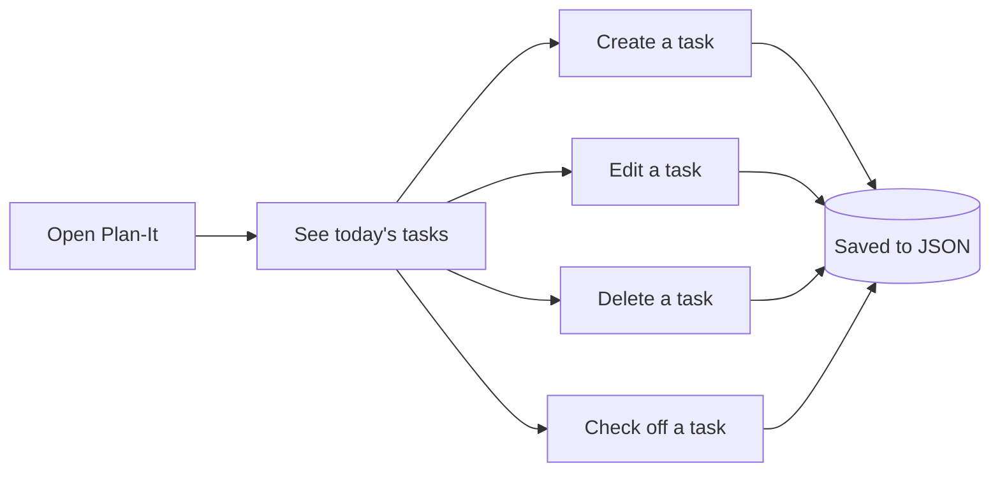

# Plan-It: Daily Planner

| | |
|---|---|
| **Author** | Eniola Akinola |
| **Date Created** | November 9, 2026 |
| **Last Updated** | November 14, 2026 |
| **Version** | 0.1 (Sprint 1) |
| **Status** | 🚧 In development, target release January 2027 |

---

## Purpose

Plan-It is a desktop app that helps users see and organize their day in one place. Users can create tasks, check them off as they finish them, and get reminders so nothing slips through the cracks.

## Who It's For

Plan-It is built for **anyone who wants a more effective day**: students juggling classes and work, professionals managing shifts and meetings, or anyone who likes having a clear plan. It's simple enough to open and start using right away, with no account or setup needed.

---

## Features

Features are prioritized using **MoSCoW** (Must, Should, Could, Won't).

### Must-have (Sprint 1)
- [ ] Create a task (title, date, time)
- [ ] View tasks in a checklist
- [ ] Mark a task as done
- [ ] Delete a task

### Should-have (Sprint 2)
- [ ] Edit a task
- [ ] Save tasks so they are still there after closing the app
- [ ] View tasks for a selected day

### Could-have (Sprint 3)
- [ ] Reminder pop-ups at the task's time
- [ ] Highlight overdue tasks
- [ ] Priority levels (High / Medium / Low) with sorting

### Won't-have (for now)
- User accounts / login
- Cloud sync across devices

---

## Tech Stack

| Area | Choice |
|---|---|
| Language | C# |
| UI Framework | Windows Forms (WinForms), .NET |
| IDE | Visual Studio |
| Testing | xUnit |
| Data Storage | Local JSON file |
| Version Control | Git (hosted on GitHub) |
| Project Management | GitHub Projects (Kanban board) |

---

## How to Run

**Requirements:** Windows 10/11, Visual Studio 2022 with the *.NET desktop development* workload.

1. Clone the repository:
   ```bash
   git clone https://github.com/EniolaAkinola/Plan-It--Daily-Planner.git
   ```
2. Open `Plan-It.sln` in Visual Studio.
3. Press **F5** (or click **Start**) to build and run.

**To run the tests:** In Visual Studio, open **Test → Test Explorer → Run All Tests**.

---

## Architecture


| Class | Responsibility |
|---|---|
| `PlannerTask` | Holds one task's data (title, due date, priority, done or not). |
| `Priority` | Enum for Low / Medium / High. |
| `Planner` | The core logic: add, edit, delete, and find tasks. **No UI code** so it can be tested on its own. |
| `ITaskStorage` | Interface for saving and loading tasks. |
| `JsonTaskStorage` | Saves and loads tasks to a JSON file. |
| `ReminderService` | Checks the time and raises an event when a reminder is due. |
| `MainForm` | The WinForms window. Handles button clicks and displays tasks, but passes all logic to `Planner`. |

### User Flow



---

## Development Approach

### Test-Driven Development (TDD)
Every feature in `Planner` is built using the **Red → Green → Refactor** cycle:

1. 🔴 **Red:** Write a test for the feature. It fails, because the code doesn't exist yet.
2. 🟢 **Green:** Write just enough code to make the test pass.
3. 🔵 **Refactor:** Clean up the code while keeping the tests passing.

**Types of tests in this project:**
- **Unit tests:** test `Planner` and `PlannerTask` logic on their own.
- **Integration tests:** test that `JsonTaskStorage` actually saves and loads correctly.
- **Manual UI testing:** click through the app to check the WinForms screens.

### Workflow
- **3 sprints**, about 1.5 weeks each
- Each feature is a **GitHub Issue** tracked on the **Plan It Board** (Todo → In Progress → Done)
- Commits reference issues (e.g., `Closes #3`) so the board updates automatically

---

## Design Decisions

*Why I made the choices I did:*

- **Why C# and WinForms?** I'm already comfortable with C# WinForms from my coursework, so I can focus on good design and testing instead of learning a new framework. It's also a quick way to build a working desktop app.
- **Why Test-Driven Development?** Most companies require tested code. Writing tests first makes me think about what the code *should* do before I write it, and it catches bugs early.
- **Why UML diagrams?** Visualizing the classes first shows me how everything connects and how the user's actions flow through the app *before* I write code. That makes the coding faster and cleaner.
- **Why keep logic out of the form?** `Planner` has no UI code, so it can be unit tested easily. If I ever build a web or mobile version, I can reuse the same logic.
- **Why an `ITaskStorage` interface?** Tests can use a fake storage instead of a real file, and I can swap JSON for a database later without changing `Planner`.
- **Why no login?** Plan-It runs locally on one computer, so accounts would add complexity without helping the user. Opening the app and creating a task right away is a better experience.
- **Why JSON for saving?** It's simple, readable, and built into .NET (`System.Text.Json`). A database would be overkill for one user's task list.
- **Why sprints and a Kanban board?** This mirrors how real software teams work: small goals, visible progress, and room to adjust.

---

## Project Structure

```
Plan-It/
├── Plan-It/              # WinForms app
│   ├── Models/           # PlannerTask, Priority
│   ├── Services/         # Planner, ReminderService
│   ├── Storage/          # ITaskStorage, JsonTaskStorage
│   └── MainForm.cs
├── Plan-It.Tests/        # xUnit tests
├── docs/                 # Diagrams, Sprint and screenshots
└── README.md
```

---

## Screenshots

*Coming soon.*

---

## Version History

| Version | Date | Notes |
|---|---|---|
| 0.1 | Nov 2026 | Project setup, README, class diagram |

---

## Author

**Eniola Akinola**
Software Engineering, Washington State University
[GitHub](https://github.com/EniolaAkinola) · [LinkedIn](https://linkedin.com/in/eniola-akinola-659167354)
